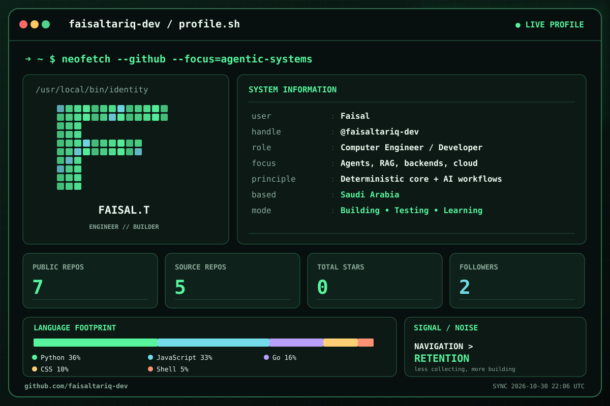

<div align="center">


# Faisal // <code>faisaltariq-dev</code>

**Computer Engineer · Agentic Software · RAG · Backend Systems**

*Information navigation over information retention.*



[Projects](#current-featured-projects) &nbsp;·&nbsp; [GitHub](https://github.com/faisaltariq-dev) &nbsp;·&nbsp; [Exam Simulator](https://github.com/faisaltariq-dev/localhost-exam-simulator) &nbsp;·&nbsp; [OrderBuilder](https://github.com/faisaltariq-dev/kioskagentordermaker-enhanced)

<sub>Dashboard generated from public GitHub data and refreshed daily by GitHub Actions. Language footprint measures public source-code bytes, not expertise.</sub>

</div>

---

#### Agentic Development

I enjoy building software at the boundary between deterministic systems and AI-driven systems, and understanding complex technologies by rebuilding simplified versions of them from first principles.

My interests include agent workflows, retrieval systems, backend engineering, applied AI, system design, deployment, and infrastructure.

Many of my projects explore questions such as:

- When should a problem be solved with code?
- When should it be solved with an agent?
- How should both approaches interact safely?
- What architectural tradeoffs emerge when AI becomes part of the software stack?

**Technical Interests**
```text
Python
FastAPI
Go
javascript
Agent Systems
RAG
LLMs
LangChain
SQLite
non-relational databases
Linux
System Design
cloud security
aws
Backend Development
APIs
Git
```

---

# Current Featured Projects

## 📝 Localhost Exam Simulator

A local, web-based exam simulator. Any AI writes the exam from one format prompt, and the app parses it into a timed exam with notes, a review list, multiple attempts and per-domain scores. It also includes an optional low-cost agent workflow for repairing exams that fail to parse, where the user approves every action the agent queues.

Repository: [localhost-exam-simulator](https://github.com/faisaltariq-dev/localhost-exam-simulator)

## 🚀 Kiosk Agent Order Maker — Enhanced Performance

A research-driven evolution of the original OrderBuilder system.

This project compares Prompting, RAG, and Fine-Tuning approaches for converting natural-language food orders into structured order JSON. It includes synthetic dataset generation, a reproducible evaluation harness, deployment infrastructure, and a fine-tuned Qwen3-8B model.

Repository: [kioskagentordermaker-enhanced](https://github.com/faisaltariq-dev/kioskagentordermaker-enhanced)

## 🍔 OrderBuilder

An AI-powered ordering platform that allows customers to build orders either through a traditional kiosk interface or through a conversational agent.

Repository: [kioskagentordermaker](https://github.com/faisaltariq-dev/kioskagentordermaker)

## 💬 Meowic

A command-line WhatsApp client built on the whatsmeow Go library, exposing multi-device messaging to coding agents either directly through the CLI or through a stdio/HTTP server that wraps the program in the Model Context Protocol that tracks every call the LLM makes.

Repository: [meowic](https://github.com/faisaltariq-dev/meowic)

## ⛓️ OpenLedger

A simplified cryptocurrency implementation demonstrating wallet generation, transaction signing, balance tracking, and blockchain-style ledger verification.

Repository: [openledger](https://github.com/faisaltariq-dev/openledger)

## 🪙 CLICrypto

A lightweight command-line cryptocurrency tracker that retrieves live market data directly from CoinGecko.

Repository: [clicrypto](https://github.com/faisaltariq-dev/clicrypto)

## 🤖 Leap-Aware Agent

A comparison of deterministic software architecture and LLM tool-calling workflows using leap-year-aware date calculations.

Repository: [leapawareagent](https://github.com/faisaltariq-dev/leapawareagent)